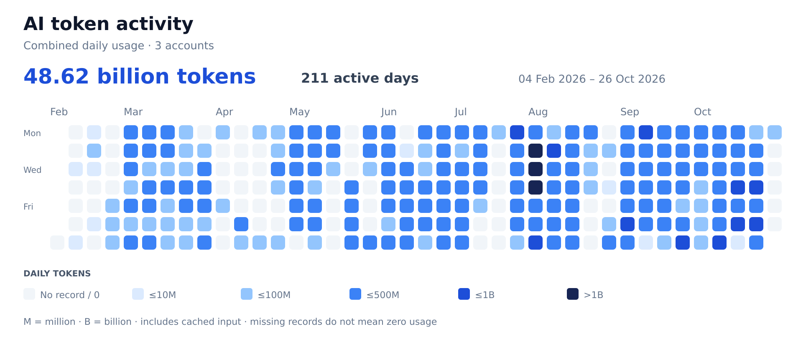

# MyScoutee Roadmap

Project boards, delivery history and AI usage across the portfolio.

| Project board | History |
| --- | --- |
| [MyScoutee](https://github.com/users/fssrepository/projects/2) | [Snapshot](guides/statistics/myscoutee/README.md) |
| [MyScoutee Template](https://github.com/users/fssrepository/projects/6) | [Snapshot](guides/statistics/myscoutee-template/README.md) |
| [MyScoutee Old](https://github.com/users/fssrepository/projects/3) | [Snapshot](guides/statistics/myscoutee-old/README.md) |
| [E-Kozig](https://github.com/users/fssrepository/projects/4) | [Snapshot](guides/statistics/e-kozig/README.md) |
| [Millennium Math Problems](https://github.com/users/fssrepository/projects/5) | [Snapshot](guides/statistics/math/README.md) |

## AI activity

Measured period: **4 February – 25 October 2026 (October 25 partial)**.

| Measurement | Tokens |
| --- | ---: |
| Current Codex account — lifetime usage | **45.890 billion** (45,889,917,699) |
| Heatmap — combined recorded daily usage across three accounts | **48.136 billion** (48,136,489,900) |

**B means billion (1,000,000,000 tokens); M means million.** Both totals include cached input. The heatmap combines the current account's retained daily records with historical records from two other accounts. It preserves the September baseline; the current account reading includes a later September correction. The two totals overlap; they are separate measurements and must not be added together or to project/task totals.

The available report measures Codex account usage. A separate ChatGPT conversation-token total is unavailable and has not been added. Other-account history remains included with its original coverage.

[Measurements](guides/statistics/myscoutee/measurements.json) · [Method](guides/statistics/myscoutee/METHOD.md) · [Daily totals](guides/statistics/account-coverage.json)

[Reconstruction tools](guides/history-tools/README.md) · [License: AGPL-3.0](LICENSE)

## Latest delivery

[MSC-128](https://github.com/fssrepository/myscoutee-roadmap/issues/165) is **Done**: shared loading/session/localization fixes, main/template **1.5.0** releases, GitHub Pages and signed full installers are published. Netcup runs the final main DEB: **9 healthy containers, 13/13 public checks**. The template release contains **14 verified assets**, including its corrected embedded client tools. [Main release](https://github.com/fssrepository/myscoutee/releases/tag/v1.5.0) · [Template release](https://github.com/fssrepository/myscoutee-template/releases/tag/v1.5.0).

Measured **24–25 October 2026**, through `2026-10-25T15:53:20.632Z`: **663,694,269 tokens**, **17.308352 active / 17.308352 allocated hours**, **3,764 unique responses**, **$222.41 Standard API equivalent**, across **ten Codex sessions**. Corrections and reverted work are included; repeated response IDs and parallel time count once.

126 tracked tasks; all 126 measured. **43,227,640,078 tokens**, **1,121.982 allocated h**, **$32,841.01 Standard API equivalent**. Costs are estimates, not invoices. These task measurements overlap account readings and are not added to them. [Measurement details](guides/statistics/myscoutee/README.md).

## Previous delivery

[MSC-126 — MyScoutee 1.4.5](https://github.com/fssrepository/myscoutee-backend/releases/tag/v1.4.5): loading groups, semantic translations, preferred-language/backend cache startup and guarded WebP/catalog/demo-lifecycle migrations. Main and applicable template releases, five GHCR images, Components 1.4.5 and standalone artifacts are published. Netcup runs 1.4.5 with **13/13 public checks**, nine healthy containers and retained production users/original media. VMware is verified. Installed DEBs remain 1.4.1; no new full template-host qualification or matched Lighthouse score is claimed. [Task](https://github.com/fssrepository/myscoutee-roadmap/issues/164) · [Evidence and remaining priorities](https://github.com/fssrepository/myscoutee-backend/blob/v1.4.5/guides/plans/MSC-126_LIGHTHOUSE_GAINS.md).

## Earlier delivery

[MSC-125 — MyScoutee 1.4.4](https://github.com/fssrepository/myscoutee-backend/releases/tag/v1.4.4): temporary, nginx-controlled landing diagnostics with a bounded memory buffer, 15-second checkpoints for the first minute and early-exit flushing. Local permission/popup/auth/render/error signals, including bounded cleaned errors and load/lifecycle/prerender/user-activation observations, go to a separate nginx log; ordinary API events are retained in the normal log. GitHub releases and GHCR nginx aliases are published and deployed to Netcup. **13/13 public checks passed** on the lifecycle-diagnostic update, all nine containers healthy; only nginx changed. Installed DEB remains 1.4.1 and API image 1.4.2. The overwritten 1.4.4 also fixes stale notification identities after logout, preserves authenticated/background server cleanup, and passes 106 notification/session regressions. The final diagnostic-detail revision passes 59 Node and 23 analyzer checks, plus a live lifecycle/error-detail round trip and original HTML request header hints. The observations do not establish the reason for an early departure. [Release notes and evidence](https://github.com/fssrepository/myscoutee-backend/blob/v1.4.4/guides/releases/v1.4.4.md).

MSC-125 measured period: **20 October 2026, 08:41:34.758–22:53:55.173 UTC**. **266,804,531 tokens**, **8.059066 active/allocated hours**, **1,526 responses**, **$85.13 Standard API equivalent**. Recovered from the dedicated implementation/release session; corrections and reverted work included.

## Versioned source release

Release `v1.5.0` provides a source archive and SHA-256 checksum through GitHub
Releases. The archive is built directly from the version tag. This repository
contains roadmap documents and reconstruction tooling, with no runtime image.
