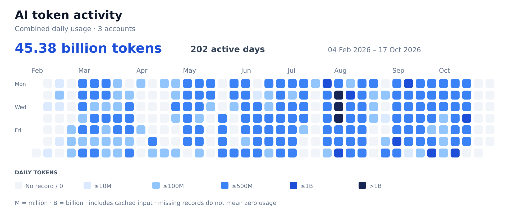

# Delivery history and project backups

The current summary merges the October 1 reconstruction with the latest measured task checkpoints. MSC-123 now records VMware/device closure and release preparation through **2026-10-17T13:24:31.611Z**; owner publication and Netcup remain open. The live Project was updated October 17. Usage is task allocation, not the account balance.

The current summary merges the October 1 reconstruction with the latest measured task checkpoints. MSC-115 is closed through QA step 119; its usage includes planning, implementation, repairs and closure through **2026-10-15T11:52:55.467000+00:00**. The live Project was checked October 15. Usage is task allocation, not the account balance.

| Project | Tracked tasks | Tasks with measurements | Tokens (M), estimated | Allocated activity (h) | API equivalent (USD), estimated |
| --- | ---: | ---: | ---: | ---: | ---: |
| [MyScoutee](https://github.com/users/fssrepository/projects/2) | 120 | 117 | 39,902.6 | 1,036.167 | $31,749.58 |
| [MyScoutee Old](https://github.com/users/fssrepository/projects/3) | 6 | 6 | 3.4 | 0.2 AI; manual unknown | $5.43 |
| [E-Kozig](https://github.com/users/fssrepository/projects/4) | 16 | 16 | 457.8 | 9.5 | $260.28 |
| [Millennium Math Problems](https://github.com/users/fssrepository/projects/5) | 18 | 18 | 1,286.0 | 43.5 | $727.68 |

**Current recorded task allocation: 42,454,913,427 tokens.** MyScoutee has 121 tracked tasks, of which 120 have usage measurements. MSC-114 remains unmeasured, not zero. Other Projects retain their measurement boundaries. Latest task checkpoints are counted once by stable task ID; account usage and the Template view are not additional task allocation.

Activity includes tool/network waits and is not human labor. Recorded overlap is removed within each measurement boundary; this refresh does not claim a new portfolio-wide overlap audit. Costs are Standard API equivalents, not invoices. Task allocation and account usage below overlap and must never be added together.

Preserved October 1 reconstruction

The following allocation table is the historical reconstruction through October 1, 2026; it is not the current account balance.

| Project | Tasks | Tokens (M), estimated | Allocated activity (h) | API equivalent (USD), estimated |
| --- | ---: | ---: | ---: | ---: |
| [MyScoutee](https://github.com/users/fssrepository/projects/2) | 111 | 36,285.0 | 890.9 | $26,863 |
| [MyScoutee Old](https://github.com/users/fssrepository/projects/3) | 6 | 3.4 | 0.2 AI; manual unknown | $5 |
| [E-Kozig](https://github.com/users/fssrepository/projects/4) | 16 | 457.8 | 9.5 | $260 |
| [Millennium Math Problems](https://github.com/users/fssrepository/projects/5) | 18 | 1,286.0 | 43.5 | $728 |

Historical estimated token allocation across the listed AI work: **38,032,141,411**. The measured usage inventory below is a separate control total, not an amount to add to project budgets. Activity time includes tool/network waits; it is not human labor time. Legacy manual effort is unknown and excluded from numeric totals. USD is a standardized API list-price comparison, not a subscription invoice or amount paid.

The original reconstruction covered 11 source repositories and 226 consolidated source commits. That reconstruction contained 151 tasks; the live tracker also contains subsequent work. The task issue records share this public tracker for stable references, while their Project boards and totals are separate. Source repository visibility is unchanged.

## Current task measurements

| Task | Tokens (M) | Active h | Allocated h | Standard API equivalent |
| --- | ---: | ---: | ---: | ---: |
| [MSC-115](https://github.com/fssrepository/myscoutee-roadmap/issues/153) | 1,328.857714 | 48.248 | 48.248 | $1,749.59 |
| [MSC-120](https://github.com/fssrepository/myscoutee-roadmap/issues/158) | 193.714624 | 10.634 | 10.588 | $252.63 |
| [MSC-121](https://github.com/fssrepository/myscoutee-roadmap/issues/159) | 634.373124 | 30.467 | 30.421 | $889.43 |
| [MSC-122](https://github.com/fssrepository/myscoutee-roadmap/issues/160) | 1,134.112133 | 43.898 | 43.898 | $1,557.73 |

MSC-115 ran October 2–15. Its **9,457 unique response records** include the three planning/implementation archive segments, two QA conversations and two guide subagents. Later MSC-116/118/119 work and the separate optimization/README/watcher work are excluded. Time is the union of recorded root task intervals; parallel guide time is not summed again. Mixed-task attribution remains estimated. The current accounting publication after the stated cutoff is excluded.

MSC-120/121/122 retain their existing measurement boundaries and recorded evidence; no application test was rerun for this accounting update. Exact model/effort components, intervals, exclusions and costs are in `myscoutee/measurements.json`. Existing Standard API rate cards are retained, not repriced; the comparison is not a subscription invoice. Each task appears once in the project summary.

## Earlier release checkpoint

[MSC-113: Granular profile ratings, fractional affinity and v1.3.3 release](https://github.com/fssrepository/myscoutee-roadmap/issues/151)
is complete. Home/Activities UI and rate sync/save/reload are verified. Two
images are deployed to Netcup; migration011 uses the shared DEB migration chain.
No DEB was built. All eight containers are healthy; six retained their identity.
Measured work through 2026-10-01T02:49:50.004Z: **28,648,921 tokens**, **1.369555 h**,
**$42.63 estimated Standard API equivalent**, gpt-6-astra / xhigh and high.
Includes implementation, QA, commits, migration, packaging, deployment and the
verifier follow-up (3/3 regressions and13/13 public checks). Final
accounting writes after cutoff cannot be self-counted. The October-1 task is
counted once; the historical allocation control and heatmap values through September 30 remain unchanged. The chart now also includes the available October records.

## Measured token activity

**Latest retained account `r` lifetime: 42,842,296,756 tokens**, read October 17, 2026. The older value remains in the historical calibration.

**45,088,868,957 tokens** in the combined retained daily record, through **October 16, 2026**. October 17 has no retained daily bucket here; it is not shown as zero. This task-level update preserves the existing account data and heatmap.

[SVG](media/token-activity.svg) · [PNG](media/token-activity.png) · [Anonymous daily totals](account-coverage.json) · [Regenerate the chart](HEATMAP.md)

Account totals overlap task measurements and are never added to task budgets. Full account identifiers and chat histories are not published. The account API reports a longest single turn of **63,694 seconds**, but **does not provide lifetime active hours**. That maximum is not total time; project/task active and allocated hours are shown separately above.

## Restore from Git

- [myscoutee backup](myscoutee/README.md)
- [myscoutee-old backup](myscoutee-old/README.md)
- [e-kozig backup](e-kozig/README.md)
- [math backup](math/README.md)

Each source repository also has a `guides/project-history/` snapshot. Complete per-Project snapshots here and compact repository-specific copies preserve issue bodies, fields, values, view definitions, token/model/time ledgers, attribution assumptions and commit mappings. No chat history is needed. Git records versions; no date-named folder is used.

## Measurement method

- Local active and archived `.codex` histories are the primary execution evidence. All 649 JSONL files were inventoried, including split conversations; the history database was checked for additional coverage. Local retained conversations start on July 22, while account daily records reach February 4.
- Reuse the existing production audit method: unique response IDs when available; positive cumulative-counter differences for older records; unchanged counters contribute nothing; an initial partial counter or reset contributes only its recorded last response. Approval-review histories are not counted as extra user work. Cached input is inside input; reasoning output is inside output.
- Reuse the frozen September 12 film/book audit without changing its 14 phase totals: **2.295 billion logged tokens**, including the separately identified product campaign. Its cutoff excludes that audit's own work. Those tokens are reserved before allocating other account activity, so they are not counted twice.
- For other tasks, date/topic evidence from original commits and conversation requests supplies allocation weights. The daily account totals are control totals. Task splits remain estimates, particularly for mixed conversations and work before local history retention. Unrelated or unsupported activity remains unassigned. 189.2 M tokens for tasks without isolated daily evidence are comparable-task estimates reserved from the unassigned account balance; their daily attribution is unavailable.
- Active time follows the existing audit's union of recorded task intervals, so overlapping root intervals are not added twice. It includes tool execution and waiting within active tasks and is not a human timesheet. Missing AI timing is estimated from comparable observed work. Manual legacy work has no time estimate; archive dates do not establish its original development period. Frozen creative tasks also retain their 15–30 minute joint-window estimates.
- Historical start/finish fields describe when the work happened. GitHub issue creation/closure dates describe this retrospective import. A historical Done record is evidence of delivered work, not a claim that the current software was retested during import.
- Logged model/effort values take precedence. When missing, the creator's stated preference for the strongest available Codex model is combined with release dates: GPT-5.3-Codex from February 5, GPT-5.4 from March 5, GPT-5.5 from April 23, GPT-5.6 Sol from July 9, GPT-6 Astra from September 3. These are explicitly estimated selections; quota-driven fallbacks and rollout timing may differ. Missing reasoning effort remains unrecorded.
- USD estimates use [OpenAI's Standard API rates](https://developers.openai.com/api/docs/pricing), valued on 2026-10-01, for input, cached input, cache writes when observed, and output. Missing token mix is estimated from observed sessions. This standardized short-context comparison excludes Fast/Ultrafast, long-context and regional uplifts, subscription charging, infrastructure, and image/video/TTS-provider credits. It is not historical billing reconciliation.

Model date sources: [GPT-5.3-Codex](https://openai.com/index/introducing-gpt-5-3-codex/), [GPT-5.4](https://openai.com/index/introducing-gpt-5-4/), [GPT-5.5](https://openai.com/index/introducing-gpt-5-5/), [GPT-5.6](https://openai.com/index/gpt-5-6/), [GPT-6 Astra](https://openai.com/index/safety-overview-gpt-6-astra/).

- Four independent Projects separate MyScoutee, the manually developed legacy archive, e-kozig and mathematical research. Shared account tokens are allocated once across all four; a Project total is never an additional account total. Historical legacy AI usage is unverified and left blank. The current AI-assisted Project-administration task is measured separately. A final shared maintenance-run measurement is apportioned by snapshot ownership; its overlap with MSC-108 is removed and its net allocation uses the unassigned account allowance, without exact daily billing reconciliation.
- Mathematical experiments and videos do not establish a solution of the continuous Navier–Stokes problem. The claim withdrawal is a first-class task.

- Combined daily usage is published as anonymous totals only. The original task calibration remains separate: additional measurements may overlap existing task evidence and are not automatically added to task tokens, hours or costs.

## Reconstruction tools

The [history helper archive](../history-tools/README.md) preserves the source scripts and workflow notes used for the reconstruction. It excludes backup bundles, credentials and private conversation extracts.

## Task identifiers

MSC, OLD, EKO and MATH IDs are stable task identifiers. Commit bodies link their actual issue numbers; task ID numbers need not equal GitHub issue numbers. Mixed commits retain their contents and can refer to several tasks. Release/archive tags retain their original targets.
